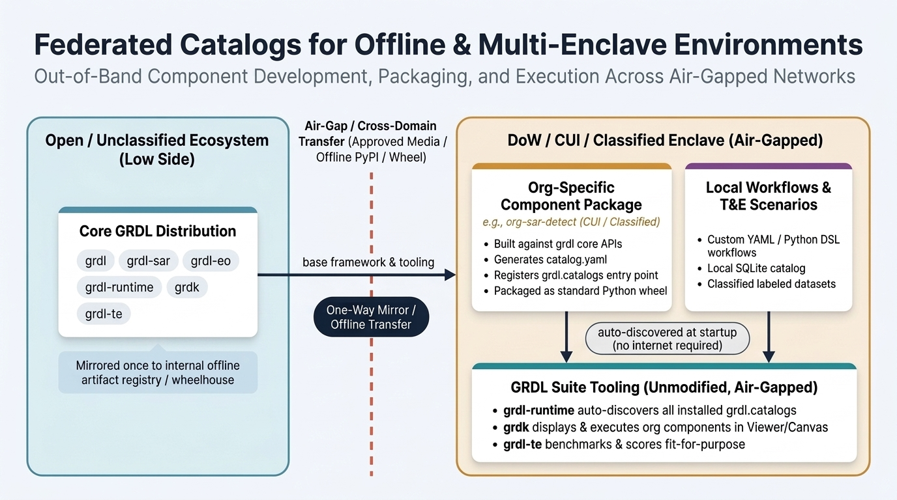

# Federated Catalogs for Offline & Multi-Enclave Environments

The GRDL suite is designed so multiple organizations can develop, package, benchmark, and deploy geospatial processing components **out-of-band** — including on **offline, air-gapped, CUI, or classified DoW networks** — without forking GRDL or upstreaming proprietary or sensitive algorithms to the public repository.

So long as a component package builds against the **`grdl` core framework** and publishes a **`grdl.catalogs`** entry point, unmodified GRDL suite tooling (**`grdl-runtime`**, **`grdk`**, and **`grdl-te`**) discovers, configures, executes, and evaluates those components alongside the standard `grdl`, `grdl-sar`, and `grdl-eo` distributions.



---

## Why Catalogs? (Non-SE Overview)

In many GEOINT programs, base sensor readers and common math live in open-source software, while mission-specific detectors, classifiers, calibration models, and operational workflows cannot leave a restricted network:

- **No central gatekeeper:** Teams do not need to merge their processors into `grdl` for analysts or test engineers to run them in GRDL tools.
- **Zero internet requirement:** Discovery reads Python package metadata and local files already installed in the environment (`catalog.yaml` and local SQLite databases). Nothing calls external registries or remote APIs at runtime.
- **Dual-use packaging:** Every catalog package remains a **standard Python library** (`import org_sar_detect`) that scripts and notebooks can call directly, while also exposing machine-readable metadata (`catalog.yaml`) for **no-code / low-code UIs (`grdk`)**, **headless orchestration (`grdl-runtime`)**, and **quantitative evaluation (`grdl-te`)**.
- **Clean separation of read-only components and local workflows:** Installed component packages supply read-only `catalog.yaml` catalogs, while analyst-recorded macros and workflows are stored separately in a local writable SQLite catalog.

---

## How Discovery Works Across the Suite

1. **One-Way Base Mirror (Low Side -> Enclave):** Mirror the open-source base suite (`grdl`, `grdl-sar`, `grdl-eo`, `grdl-runtime`, `grdk`, `grdl-te`) into your internal offline artifact repository (wheelhouse, internal PyPI, or conda channel).
2. **Out-of-Band Component Development (Inside the Enclave):** Developers author CUI or classified processors in their own repository (for example, `org-sar-detect`), subclassing `grdl` base classes (`ImageTransform`, `ImageDetector`, `PolarimetricDecomposition`, etc.) and annotating parameters/tags.
3. **Static Catalog Generation:** During build/packaging, `grdl.discovery.catalog_builder` introspects those decorators and emits a static `catalog.yaml` bundled inside the wheel.
4. **Automatic Startup Federation:** On launch in the air-gapped environment:
   - **`grdl-runtime`** (`discover_entry_point_catalogs()` / `build_default_catalog()`) queries Python's `grdl.catalogs` entry-point group, loads every installed package's `catalog.yaml`, and federates them with the local SQLite catalog (`~/.grdl/catalog.db` or `GRDK_CATALOG_PATH`) into a `FederatedArtifactCatalog`.
   - **`grdk`** (`CatalogManager`) automatically lists discovered entry-point catalogs in the Catalog Manager and Catalog Runner UIs while routing workflow/macro writes (`get_writable_catalog()`) to the local SQLite database.
   - **`grdl-te`** executes quantitative fit-for-purpose evaluations and benchmarks against enclave processors using curated, labeled scenario datasets.

---

## Example: Building & Deploying an Offline DoW / CUI Package (`org-sar-detect`)

### 1. Implement Against `grdl` Core Interfaces

Your package depends only on `grdl` (plus standard scientific Python libraries) — it does **not** need to depend on `grdl-runtime` or `grdk`:

```python
# org_sar_detect/detectors/maritime.py
import numpy as np
from grdl.image_processing.base import ImageTransform
from grdl.image_processing.versioning import processor_tags, processor_version
from grdl.vocabulary import ImageModality, ProcessorCategory


@processor_version("1.2.0")
@processor_tags(
    modalities=[ImageModality.SAR],
    category=ProcessorCategory.DETECTION,
)
class MaritimeContrastDetector(ImageTransform):
    """Example CUI detector built solely against grdl core APIs."""

    def __init__(self, threshold_db: float = 12.0) -> None:
        self.threshold_db = threshold_db

    def apply(self, source: np.ndarray, **kwargs) -> np.ndarray:
        return (source > self.threshold_db).astype(np.uint8)
```

Because `MaritimeContrastDetector` implements the standard `grdl` interface, Python developers can import and use it directly anywhere:

```python
from org_sar_detect.detectors.maritime import MaritimeContrastDetector

mask = MaritimeContrastDetector(threshold_db=14.0).apply(sar_chip)
```

### 2. Expose `get_catalog_path()` and Register `grdl.catalogs`

Expose a helper returning the path to the bundled `catalog.yaml`:

```python
# org_sar_detect/__init__.py
from pathlib import Path

from org_sar_detect.detectors.maritime import MaritimeContrastDetector

__all__ = ["MaritimeContrastDetector", "get_catalog_path"]


def get_catalog_path() -> Path:
    """Return the path to the bundled catalog.yaml for grdl.catalogs discovery."""
    return Path(__file__).resolve().parent / "catalog.yaml"
```

Register the entry point and ensure `catalog.yaml` is included in package data in `pyproject.toml`:

```toml
[project]
name = "org-sar-detect"
version = "1.2.0"
dependencies = [
    "grdl>=0.8.1",
    "numpy>=2.0.0",
]

[project.entry-points."grdl.catalogs"]
org_sar_detect = "org_sar_detect:get_catalog_path"

[tool.setuptools]
include-package-data = true

[tool.setuptools.packages.find]
include = ["org_sar_detect*"]

[tool.setuptools.package-data]
org_sar_detect = ["catalog.yaml"]
```

### 3. Generate `catalog.yaml` & Build Offline Artifacts

Run the built-in catalog generator before building your wheel or conda package:

```bash
python -m grdl.discovery.catalog_builder org_sar_detect -o org_sar_detect/catalog.yaml --dist-name org-sar-detect
python -m build --wheel --no-isolation
```

If a package ships without a pre-generated `catalog.yaml`, `grdl-runtime` can also synthesize catalog entries in memory via `grdl.discovery.catalog_builder.build_catalog_data()`, though shipping `catalog.yaml` inside the wheel is faster and deterministic for air-gapped deployments.

### 4. Deploy into an Air-Gapped Environment

Install from an offline wheelhouse or internal registry alongside the mirrored GRDL suite:

```bash
pip install --no-index --find-links /path/to/wheelhouse grdl-runtime grdk org-sar-detect
```

Verify discovery without network access:

```python
from grdl_rt.execution.discovery import discover_processors

processors = discover_processors()
assert "MaritimeContrastDetector" in processors
```

---

## Managing Local Workflows & Enclave Hygiene

- **Read-only component catalogs vs. local writable storage:** Entry-point `catalog.yaml` files inside site-packages are treated as read-only. User-created workflows and recorded macros in `grdk` are saved to the local SQLite database (`~/.grdl/catalog.db` by default, or overridden via `GRDK_CATALOG_PATH` / `~/.grdl/config.json`).
- **Environment isolation:** Set `GRDK_CATALOG_PATH` to point at a mission- or classification-scoped SQLite database (for example, `/enclave/project_a/catalog.db`) to keep workflows separated by security context or program.
- **Fit-for-purpose validation:** Because `grdl-te` consumes the same `grdl` APIs and component contracts, enclave T&E teams can evaluate `org-sar-detect` processors and workflows directly against classified ground-truth datasets without modifying `grdl-te` itself.
